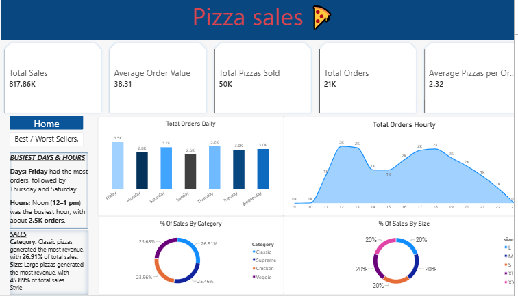
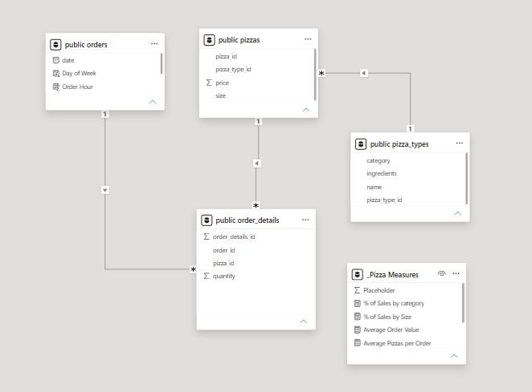
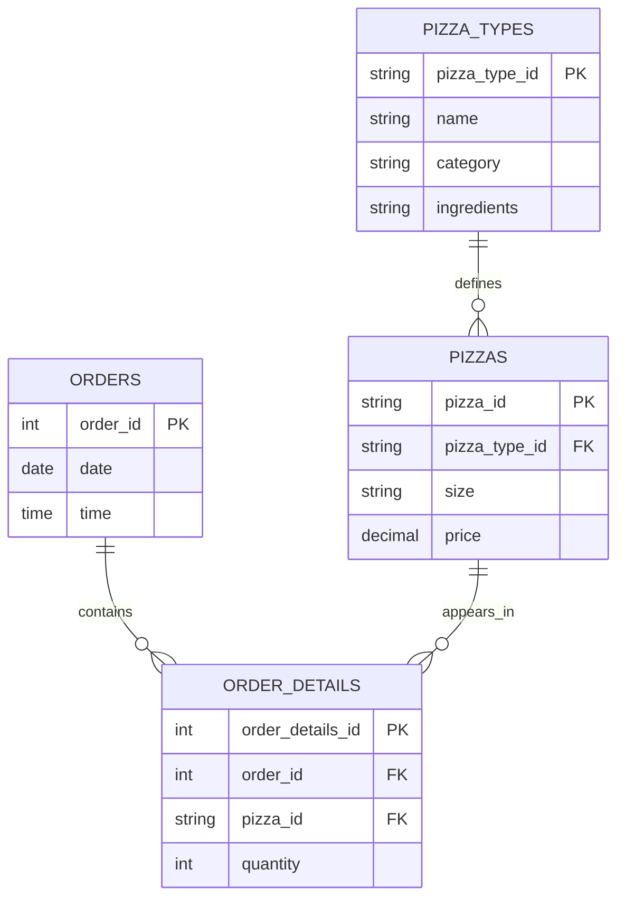
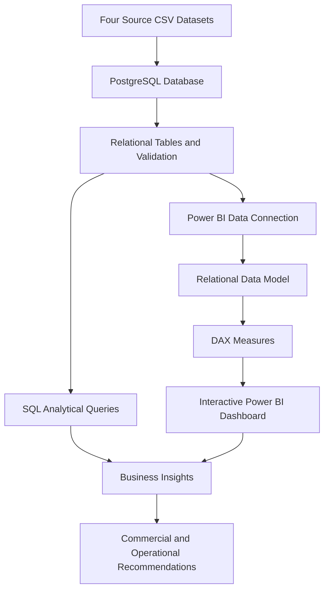

# Pizza Sales Analysis | PostgreSQL & Microsoft Power BI


## Project Overview

This end-to-end data analytics project combines PostgreSQL and Microsoft Power BI to investigate the sales performance of a fictional pizza restaurant.

Using a relational dataset containing 48,620 order-line records across 21,350 orders, the project analyses revenue performance, customer ordering patterns, product popularity and commercial trends throughout 2015.

The project demonstrates the complete analytical workflow, from relational database preparation and SQL-based analysis to Power BI data modelling, DAX calculations, interactive dashboard development and business recommendation generation.

The objective is to provide restaurant management with meaningful insights that could support operational efficiency, menu optimisation, resource allocation and revenue performance.

## Dashboard Preview



## Executive Summary

| Key Performance Indicator | Result |
|---|---:|
| Total Sales Revenue | $817,860.05 |
| Total Orders | 21,350 |
| Total Pizzas Sold | 49,574 |
| Average Order Value | $38.31 |
| Average Pizzas per Order | 2.32 |
| Pizza Types | 32 |
| Pizza Variants | 96 |
| Product Categories | 4 |
| Highest Revenue Category | Classic |
| Most Popular Pizza Size by Revenue | Large |
| Best-Selling Pizza by Quantity | Classic Deluxe |
| Lowest-Selling Pizza by Quantity | Brie Carre |
| Busiest Day by Total Orders | Friday |
| Busiest Hour by Total Orders | 12:00–12:59 |

The analysis identifies strong demand during lunchtime and evening periods, a substantial contribution from large pizzas and clear differences in product popularity.

These findings provide opportunities to investigate staffing requirements, inventory planning, promotional strategies and menu performance.

The headline figures were independently recalculated from the four source CSV datasets.

## Business Problem

Restaurant management requires reliable sales information to understand customer demand, identify commercially important products and allocate operational resources effectively.

Without structured sales reporting, businesses may struggle to:

- Identify peak ordering periods.
- Understand revenue contributions across products.
- Determine which menu items generate the strongest demand.
- Identify potentially underperforming products.
- Plan staffing requirements effectively.
- Manage ingredient inventory.
- Evaluate customer purchasing behaviour.
- Develop commercially informed promotional strategies.

This project addresses these requirements through a combined SQL and Power BI analytical solution.

## Project Objectives

- Establish a relational PostgreSQL database.
- Analyse annual sales revenue.
- Calculate key commercial performance indicators.
- Evaluate average customer order value.
- Identify daily and hourly ordering patterns.
- Compare revenue contributions across pizza categories.
- Analyse sales performance by pizza size.
- Identify the highest and lowest-selling products.
- Develop interactive Power BI dashboards.
- Translate analytical findings into potential operational and commercial recommendations.

## Tools and Technologies

| Tool / Technique | Application |
|---|---|
| PostgreSQL | Relational database management and analytical querying |
| SQL | Data extraction, aggregation and commercial analysis |
| pgAdmin | Database administration and query execution |
| Microsoft Power BI Desktop | Interactive business intelligence reporting |
| Power Query | Data connection and preparation |
| DAX | Financial and operational KPI calculations |
| Relational Data Modelling | Establishing relationships between analytical tables |
| Primary and Foreign Keys | Maintaining relational data integrity |
| Aggregate Functions | Revenue, quantity and order calculations |
| SQL Subqueries | Percentage-of-total calculations |
| Date and Time Functions | Customer ordering pattern analysis |
| CSV | Relational source data storage |
| GitHub | Project documentation and version control |

## Dataset Overview

The project uses the Pizza Place Sales dataset available through Maven Analytics.

The dataset represents a fictional pizza restaurant and contains detailed order information, pizza classifications, product sizes, prices and ingredient descriptions.

| Dataset Characteristic | Description |
|---|---|
| Source | Maven Analytics Data Playground |
| Dataset | Pizza Place Sales |
| Reporting Period | 1 January 2015 – 31 December 2015 |
| Data Granularity | Order and order-line level |
| Order Records | 21,350 |
| Order-Line Records | 48,620 |
| Pizza Types | 32 |
| Pizza Variants | 96 |
| Pizza Categories | 4 |
| Currency | US Dollars |
| Dataset Licence | Public Domain |

### Source Tables

| Table | Records | Description |
|---|---:|---|
| orders | 21,350 | Order identifiers, dates and times |
| order_details | 48,620 | Individual order lines, pizza identifiers and quantities |
| pizzas | 96 | Pizza variants, sizes and unit prices |
| pizza_types | 32 | Pizza names, categories and ingredient descriptions |

### Data Dictionary

| Table | Column | Description |
|---|---|---|
| orders | order_id | Unique order identifier |
| orders | date | Date the order was placed |
| orders | time | Time the order was placed |
| order_details | order_details_id | Unique order-line identifier |
| order_details | order_id | Associated customer order |
| order_details | pizza_id | Associated pizza variant |
| order_details | quantity | Number of pizzas ordered |
| pizzas | pizza_id | Unique pizza variant identifier |
| pizzas | pizza_type_id | Associated pizza type |
| pizzas | size | Pizza size classification |
| pizzas | price | Unit selling price |
| pizza_types | pizza_type_id | Unique pizza type identifier |
| pizza_types | name | Pizza product name |
| pizza_types | category | Pizza category |
| pizza_types | ingredients | Product ingredient description |

## Relational Data Model



The project uses four interconnected source tables.

The order_details table provides the central transactional detail, while the orders, pizzas and pizza_types tables provide associated order and product information.

### Logical Database Relationships

| Parent Table | Related Table | Relationship | Joining Column |
|---|---|---|---|
| orders | order_details | One-to-Many | order_id |
| pizzas | order_details | One-to-Many | pizza_id |
| pizza_types | pizzas | One-to-Many | pizza_type_id |

### Database Relationship Diagram



The relational structure reduces unnecessary duplication of product information and supports analysis across multiple business dimensions.

Product details can be joined to individual transactions using pizza identifiers, while order dates and times can be linked through the order identifier.

The same relational principles support the Power BI analytical model.

## Data Preparation and Validation

The four CSV datasets were reviewed to establish their structure and relational compatibility.

Data preparation and validation considerations included:

- Identifying unique primary keys.
- Establishing appropriate numerical and text data types.
- Preserving order dates and transaction times.
- Maintaining decimal precision for product prices.
- Identifying duplicate primary keys.
- Checking for unmatched foreign keys.
- Reconciling source table record counts.
- Validating revenue and quantity calculations.

Independent source-data checks found no duplicate primary keys or unmatched foreign keys across the expected table relationships.

The database setup script provides a reproducible structure for importing the four source datasets into PostgreSQL.

## Analytical Workflow



## SQL Analysis

The original SQL analysis contains 12 business-focused queries.

The complete SQL script is available here:

[Pizza_Sales_Analysis.sql](Pizza_Sales_Analysis.sql)

### Business Questions Addressed

| Query | Business Question | SQL Techniques |
|---:|---|---|
| 1 | What was the total sales revenue? | SUM, INNER JOIN, ROUND |
| 2 | What was the average order value? | SUM, COUNT DISTINCT, NULLIF |
| 3 | How many pizzas were sold? | SUM |
| 4 | How many orders were placed? | COUNT DISTINCT |
| 5 | How many pizzas were sold per order on average? | SUM, Numeric Conversion, NULLIF |
| 6 | How many orders were placed on each day? | TO_CHAR, GROUP BY |
| 7 | How many orders were placed during each hour? | EXTRACT, GROUP BY |
| 8 | What percentage of revenue came from each category? | Multiple Joins, Subquery |
| 9 | What percentage of revenue came from each size? | Multiple Joins, Subquery |
| 10 | How many pizzas were sold within each category? | Multiple Joins, SUM |
| 11 | Which five pizza types sold the most units? | GROUP BY, ORDER BY, LIMIT |
| 12 | Which five pizza types sold the fewest units? | GROUP BY, ORDER BY, LIMIT |

### Query 1 — Total Sales Revenue

```sql
SELECT
    ROUND(SUM(price * quantity), 2) AS total_revenue
FROM pizzas p
INNER JOIN order_details o
    ON p.pizza_id = o.pizza_id;
```

**Result:** $817,860.05

Revenue is calculated by multiplying each pizza's unit selling price by its ordered quantity and aggregating the resulting order-line values.

### Query 2 — Average Order Value

```sql
SELECT
    ROUND(
        SUM(quantity * price)
        / NULLIF(COUNT(DISTINCT order_id), 0),
        2
    ) AS average_order_value
FROM pizzas p
INNER JOIN order_details o
    ON p.pizza_id = o.pizza_id;
```

**Result:** $38.31

Average order value measures the average revenue generated per unique order.

NULLIF protects the calculation against division-by-zero errors.

### Query 3 — Total Pizzas Sold

```sql
SELECT
    SUM(quantity) AS total_pizzas_sold
FROM order_details;
```

**Result:** 49,574 pizzas.

This calculation uses transaction quantities rather than simply counting order-line records.

### Query 4 — Total Orders

```sql
SELECT
    COUNT(DISTINCT order_id) AS total_orders
FROM order_details;
```

**Result:** 21,350 orders.

DISTINCT prevents orders containing multiple products from being counted more than once.

### Query 5 — Average Pizzas per Order

```sql
SELECT
    ROUND(
        SUM(quantity)::NUMERIC
        / NULLIF(COUNT(DISTINCT order_id), 0),
        2
    ) AS average_pizza_per_order
FROM order_details;
```

**Result:** 2.32 pizzas per order.

Numeric conversion ensures that fractional results are retained.

### Query 6 — Orders by Day of Week

```sql
SELECT
    TO_CHAR(date, 'FMDay') AS day_of_week,
    COUNT(DISTINCT order_id) AS total_orders
FROM orders
GROUP BY TO_CHAR(date, 'FMDay')
ORDER BY total_orders DESC;
```

This query identifies which days generate the highest cumulative ordering demand.

### Query 7 — Orders by Hour

```sql
SELECT
    EXTRACT(HOUR FROM time) AS hour,
    COUNT(DISTINCT order_id) AS total_orders
FROM orders
GROUP BY EXTRACT(HOUR FROM time)
ORDER BY hour;
```

This query supports identification of peak trading periods and potential staffing requirements.

### Query 8 — Revenue Percentage by Category

```sql
SELECT
    pt.category,
    SUM(p.price * o.quantity) AS total_revenue,
    ROUND(
        SUM(p.price * o.quantity) * 100
        / NULLIF(
            (
                SELECT SUM(p2.price * o2.quantity)
                FROM pizzas p2
                INNER JOIN order_details o2
                    ON p2.pizza_id = o2.pizza_id
            ),
            0
        ),
        2
    ) AS percentage_sales
FROM pizzas p
INNER JOIN pizza_types pt
    ON p.pizza_type_id = pt.pizza_type_id
INNER JOIN order_details o
    ON p.pizza_id = o.pizza_id
GROUP BY pt.category
ORDER BY percentage_sales DESC;
```

This query calculates each product category's contribution to total annual revenue.

The subquery establishes the overall revenue denominator against which individual categories are compared.

### Query 9 — Revenue Percentage by Pizza Size

The same percentage-of-total methodology is applied to pizza sizes to investigate customer preferences and revenue concentration.

### Query 10 — Quantity Sold by Category

Sales quantities are aggregated across the four product categories to distinguish product demand from revenue performance.

### Queries 11 and 12 — Best and Worst-Selling Products

```sql
SELECT
    pt.name,
    SUM(o.quantity) AS quantity_sold
FROM pizzas p
INNER JOIN pizza_types pt
    ON p.pizza_type_id = pt.pizza_type_id
INNER JOIN order_details o
    ON p.pizza_id = o.pizza_id
GROUP BY pt.name
ORDER BY quantity_sold DESC
LIMIT 5;
```

The lowest-selling products are identified by reversing the sort direction to ascending order.

This methodology aggregates sales across all available sizes of each pizza type.

## Power BI Dashboard Development

Microsoft Power BI is used to transform the relational sales data into an interactive business intelligence reporting solution.

The report includes two analytical pages:

### Page 1 — Sales Performance Overview

The overview focuses on core commercial metrics and sales patterns.

The report supports analysis of:

- Total sales revenue.
- Total customer orders.
- Total pizzas sold.
- Average order value.
- Average pizzas per order.
- Orders by day of the week.
- Orders by hour.
- Revenue contribution by category.
- Revenue contribution by pizza size.
- Product category sales volumes.

### Page 2 — Product Performance

The product performance page focuses on identifying high-demand and low-demand pizza products.

Product-level comparisons provide management with a starting point for investigating menu performance, inventory requirements and promotional opportunities.

The SQL script includes top-five and bottom-five product analyses.

The exact visual ranking settings can be inspected within the Power BI report.

## DAX Measures and KPI Methodology

DAX calculations provide reusable financial and operational metrics within the Power BI reporting environment.

The following examples illustrate the core calculation logic used to reproduce the project KPIs.

Measure names and table references can be adjusted to match the report's internal naming conventions.

### Total Sales

```dax
Total Sales =
SUMX(
    order_details,
    order_details[quantity] *
    RELATED(pizzas[price])
)
```

SUMX evaluates revenue at the transaction-line level before aggregating the resulting values.

### Total Orders

```dax
Total Orders =
DISTINCTCOUNT(order_details[order_id])
```

### Total Pizzas Sold

```dax
Total Pizzas Sold =
SUM(order_details[quantity])
```

### Average Order Value

```dax
Average Order Value =
DIVIDE(
    [Total Sales],
    [Total Orders],
    0
)
```

### Average Pizzas per Order

```dax
Average Pizzas per Order =
DIVIDE(
    [Total Pizzas Sold],
    [Total Orders],
    0
)
```

### Percentage of Sales by Category

```dax
Category Sales Percentage =
DIVIDE(
    [Total Sales],
    CALCULATE(
        [Total Sales],
        ALL(pizza_types[category])
    ),
    0
)
```

This measure compares category-level revenue against the revenue total across categories while retaining other applicable report filters.

### Percentage of Sales by Size

```dax
Size Sales Percentage =
DIVIDE(
    [Total Sales],
    CALCULATE(
        [Total Sales],
        ALL(pizzas[size])
    ),
    0
)
```

These examples demonstrate how SQL aggregation logic can be translated into reusable DAX calculations.

The examples illustrate equivalent KPI logic rather than independently extracted copies of every saved Power BI measure.

## Key Analytical Findings

### 1. Annual Revenue Performance

The restaurant generated total annual sales revenue of $817,860.05 across 21,350 orders.

| Commercial Metric | Result |
|---|---:|
| Annual Revenue | $817,860.05 |
| Average Monthly Revenue | $68,155.00 |
| Average Order Value | $38.31 |
| Average Pizzas per Order | 2.32 |
| Total Units Sold | 49,574 |

An average order contains more than two pizzas, providing a potential opportunity to investigate multi-pizza meal offers and complementary product promotions.

However, the existing dataset does not establish whether promotions would increase overall profitability.

**Business implication:** Management could test carefully designed basket-value promotions and evaluate their effect on revenue, contribution margin and average order value.

### 2. Classic Pizzas Generate the Highest Revenue

| Pizza Category | Revenue | Revenue Contribution | Quantity Sold |
|---|---:|---:|---:|
| Classic | $220,053.10 | 26.91% | 14,888 |
| Supreme | $208,197.00 | 25.46% | 11,987 |
| Chicken | $195,919.50 | 23.95% | 11,050 |
| Veggie | $193,690.45 | 23.68% | 11,649 |
| Total | $817,860.05 | 100.00% | 49,574 |

Classic pizzas generate the highest revenue and the highest sales quantity.

The category accounts for approximately 30.03% of all pizzas sold.

Revenue is relatively evenly distributed across the four categories, with each contributing approximately one-quarter of total annual revenue.

**Business implication:** Management should maintain strong availability across all four categories while prioritising sufficient inventory for high-volume Classic products.

### 3. Revenue Contribution by Pizza Size

| Pizza Size | Total Revenue | Revenue Contribution |
|---|---:|---:|
| Large | $375,318.70 | 45.89% |
| Medium | $249,382.25 | 30.49% |
| Small | $178,076.50 | 21.77% |
| Extra Large | $14,076.00 | 1.72% |
| Extra Extra Large | $1,006.60 | 0.12% |

Large pizzas generate approximately 45.89% of total revenue.

Large and medium pizzas collectively contribute approximately 76.38% of annual sales revenue.

Extra-large and extra-extra-large pizzas generate comparatively low revenue contributions.

However, not every pizza type is available in every size, so lower revenue does not independently establish weaker customer preference.

**Business implication:** Inventory planning and promotional strategies should reflect demand for the most commercially important sizes while accounting for product availability and margins.

### 4. Friday Generates the Highest Order Volume

| Day | Total Orders |
|---|---:|
| Friday | 3,538 |
| Thursday | 3,239 |
| Saturday | 3,158 |
| Wednesday | 3,024 |
| Tuesday | 2,973 |
| Monday | 2,794 |
| Sunday | 2,624 |

Friday represents the busiest day by cumulative annual order volume.

Sunday records the lowest cumulative order volume.

Friday generates approximately 34.83% more orders than Sunday.

Differences in trading days and opening schedules should be considered before interpreting these totals as average daily demand.

**Business implication:** Management could review Friday staffing levels, kitchen preparation requirements and ingredient availability to support higher ordering demand.

### 5. Lunchtime and Early Evening Are Important Trading Periods

| Hour | Total Orders |
|---|---:|
| 12:00–12:59 | 2,520 |
| 13:00–13:59 | 2,455 |
| 18:00–18:59 | 2,399 |
| 17:00–17:59 | 2,336 |
| 19:00–19:59 | 2,009 |

The busiest individual hour is between 12:00 and 12:59.

The combined lunchtime periods from 12:00 to 13:59 account for 4,975 orders, approximately 23.30% of annual orders.

The three evening hours between 17:00 and 19:59 account for 6,744 orders, approximately 31.59% of annual orders.

Collectively, these five hours account for approximately 54.89% of all recorded orders.

**Business implication:** Staffing, kitchen capacity and ingredient preparation should be reviewed around lunchtime and early evening demand.

### 6. Best-Selling Pizza Products

| Rank | Pizza Type | Quantity Sold |
|---:|---|---:|
| 1 | The Classic Deluxe Pizza | 2,453 |
| 2 | The Barbecue Chicken Pizza | 2,432 |
| 3 | The Hawaiian Pizza | 2,422 |
| 4 | The Pepperoni Pizza | 2,418 |
| 5 | The Thai Chicken Pizza | 2,371 |

The Classic Deluxe Pizza is the highest-selling pizza type by quantity.

The five leading products collectively account for 12,096 pizzas, approximately 24.40% of total units sold.

**Business implication:** Management could prioritise ingredient availability and monitor stock requirements for these high-demand products.

### 7. Lowest-Selling Pizza Products

| Rank | Pizza Type | Quantity Sold |
|---:|---|---:|
| 1 | The Brie Carre Pizza | 490 |
| 2 | The Mediterranean Pizza | 934 |
| 3 | The Calabrese Pizza | 937 |
| 4 | The Spinach Supreme Pizza | 950 |
| 5 | The Soppressata Pizza | 961 |

The Brie Carre Pizza records the lowest sales quantity.

Its total sales volume is substantially below that of the next lowest-selling product.

However, lower sales volume does not necessarily indicate poor profitability or justify removing the product from the menu.

**Business implication:** Management should investigate product margins, size availability, ingredient waste and customer demand before making menu rationalisation decisions.

## Business Recommendations

| Analytical Finding | Recommended Action | Potential Business Benefit |
|---|---|---|
| Large pizzas generate 45.89% of revenue | Prioritise inventory planning for large pizza production | Improved product availability |
| Friday generates the most orders | Review Friday staffing and preparation schedules | Better operational capacity |
| Strong lunchtime and evening demand | Align staffing with peak trading periods | Improved service efficiency |
| Classic products lead sales volumes | Monitor inventory requirements for popular Classic pizzas | Reduced risk of product unavailability |
| Five leading products generate substantial sales | Investigate product-specific demand forecasting | More informed purchasing decisions |
| Brie Carre records relatively low demand | Review profitability, product availability and ingredient costs | Better-informed menu decisions |
| Average order value is $38.31 | Test multi-product meal offers and evaluate results | Potential basket-value improvement |
| Average order contains 2.32 pizzas | Investigate multi-pizza customer purchasing behaviour | More targeted promotional strategies |
| Revenue is distributed across four categories | Maintain category-level performance reporting | Improved commercial visibility |
| Extra-large sizes generate relatively low revenue | Evaluate available product ranges and size-specific margins | Better-informed product range decisions |

These recommendations represent potential business actions derived from the analysis.

The project does not claim that these recommendations have been implemented or that any financial improvements have been realised.

## Practical Business Applications

### Commercial Analysis

- Monitoring revenue and order performance.
- Evaluating product category contributions.
- Identifying commercially important products.
- Supporting promotional strategy discussions.

### Operations Analysis

- Identifying peak trading periods.
- Supporting staffing and resource planning.
- Evaluating demand across different days and hours.
- Identifying opportunities for improved operational preparation.

### Inventory Planning

- Identifying high-volume products.
- Supporting ingredient demand assessments.
- Investigating potentially underutilised menu items.
- Establishing a foundation for inventory forecasting.

### Management Information Reporting

- Developing reusable commercial KPIs.
- Presenting business performance through interactive dashboards.
- Supporting management discussions with structured reporting.
- Translating transactional information into actionable insights.

## Analytical Limitations

- The dataset represents a fictional restaurant rather than an actual operating business.
- The analysis covers a single historical reporting year.
- Unique customer identifiers are unavailable.
- Customer orders cannot be interpreted as unique customer counts.
- Product ingredient costs are not provided.
- Gross profit and contribution margins cannot be calculated reliably.
- Labour costs and staffing information are unavailable.
- Product availability and stockout information are not included.
- Sales quantity does not independently establish product profitability.
- Not all pizza types are offered in every available size.
- Cumulative orders by day do not account for differences in trading days or operating schedules.
- External factors affecting demand are unavailable.
- Observed sales patterns do not establish causal relationships.
- Recommendations require further financial and operational validation before implementation.

## Opportunities for Further Development

Potential extensions include:

- Monthly and quarterly revenue trend analysis.
- Year-to-date financial reporting.
- Seasonal demand analysis.
- Revenue forecasting.
- Product profitability analysis using ingredient costs.
- Contribution margin analysis.
- Inventory demand forecasting.
- Basket composition and product combination analysis.
- Customer segmentation if customer identifiers become available.
- Promotion effectiveness analysis.
- Automated PostgreSQL data pipelines.
- Scheduled Power BI report refresh.
- Additional DAX time intelligence calculations.
- Operational performance targets and variance reporting.

## Repository Structure

| File | Description |
|---|---|
| [Pizza_Sales_Analysis.pbix](Pizza_Sales_Analysis.pbix) | Interactive Microsoft Power BI report |
| [Pizza_Sales_Analysis.sql](Pizza_Sales_Analysis.sql) | Original 12 SQL analytical queries |
| [Database_Setup.sql](Database_Setup.sql) | PostgreSQL table creation and import instructions |
| [orders.csv](orders.csv) | Source order records |
| [order_details.csv](order_details.csv) | Source transaction-line records |
| [pizzas.csv](pizzas.csv) | Pizza variants, sizes and prices |
| [pizza_types.csv](pizza_types.csv) | Pizza names, categories and ingredients |
| [Dashboard_Preview.png](Dashboard_Preview.png) | Power BI dashboard preview |
| [Data_Model.png](Data_Model.png) | Power BI data model preview |
| README.md | Technical documentation, analytical findings and business recommendations |

## How to Reproduce the SQL Analysis

### Prerequisites

- PostgreSQL
- pgAdmin or another PostgreSQL-compatible database client
- Four source CSV datasets

### Step 1 — Create the Database

Create a PostgreSQL database named:

```sql
CREATE DATABASE pizza_sales;
```

Connect to the newly created database.

### Step 2 — Create the Tables

Open and execute the table creation statements within:

[Database_Setup.sql](Database_Setup.sql)

The script defines the four relational tables and their expected relationships.

### Step 3 — Import the Source Data

Import the four CSV datasets in the following order to satisfy foreign-key dependencies:

1. pizza_types.csv
2. pizzas.csv
3. orders.csv
4. order_details.csv

Enable the CSV header option during import.

Select the appropriate source encoding if the product descriptions contain characters that cannot be imported using the default encoding.

### Step 4 — Validate the Imported Data

Confirm the following expected record counts:

| Table | Expected Records |
|---|---:|
| pizza_types | 32 |
| pizzas | 96 |
| orders | 21,350 |
| order_details | 48,620 |

Check that all primary keys are unique and that all foreign-key relationships resolve successfully.

### Step 5 — Execute the Analysis

Open:

[Pizza_Sales_Analysis.sql](Pizza_Sales_Analysis.sql)

Execute the 12 analytical queries and compare the resulting figures with the executive summary and documented findings.

### Expected KPI Validation

| KPI | Expected Result |
|---|---:|
| Total Revenue | 817860.05 |
| Total Orders | 21350 |
| Total Pizzas Sold | 49574 |
| Average Order Value | 38.31 |
| Average Pizzas per Order | 2.32 |

The reference results were independently recalculated from the source CSV datasets.

The database setup script should be tested in PostgreSQL before being used in another environment.

## How to Explore the Power BI Dashboard

1. Download Pizza_Sales_Analysis.pbix.
2. Open the report using Microsoft Power BI Desktop.
3. Navigate to the sales performance overview page.
4. Review the headline commercial KPIs.
5. Explore daily and hourly ordering patterns.
6. Review product category and pizza size performance.
7. Navigate to the product performance page.
8. Review the highest and lowest-selling products.
9. Open Model View to inspect the table relationships.

## Refreshing the Power BI Data Source

The project was developed using PostgreSQL as the relational data source.

To refresh the report on another computer:

1. Recreate the PostgreSQL database using the supplied setup script.
2. Import the four CSV datasets.
3. Open the Power BI report.
4. Navigate to Home > Transform Data > Data Source Settings.
5. Review the existing PostgreSQL connection.
6. Update the server and database connection details as necessary.
7. Authenticate using your own database credentials.
8. Apply the changes and refresh the report.
9. Reconcile the dashboard KPIs against the expected validation figures.

Do not include database passwords or other sensitive connection credentials in a public repository.

The source refresh process on a separate computer has not been independently tested.

## Skills Demonstrated

### SQL and Database Skills

- PostgreSQL
- Relational database design
- Primary and foreign keys
- INNER JOIN operations
- Multiple table joins
- Aggregate functions
- SQL subqueries
- Percentage-of-total calculations
- Numeric data type conversion
- Distinct record counting
- Date and time functions
- NULLIF error prevention
- Product ranking
- Data validation
- Commercial query development

### Power BI Skills

- Microsoft Power BI Desktop
- PostgreSQL data connectivity
- Power Query
- Relational data modelling
- DAX calculations
- SUMX and row-level evaluation
- Distinct count measures
- Ratio calculations
- Filter context
- KPI development
- Interactive reporting
- Dashboard development
- Data visualisation
- Business intelligence reporting

### Business and Analytical Skills

- Sales performance analysis
- Revenue analysis
- Average order value analysis
- Product performance analysis
- Commercial analysis
- Operational performance analysis
- Customer ordering pattern analysis
- Demand identification
- Product category analysis
- Inventory planning insights
- Management information reporting
- Business recommendation development
- Critical evaluation of analytical limitations

## Conclusion

This project demonstrates how PostgreSQL and Microsoft Power BI can be combined to deliver an end-to-end business intelligence and commercial analytics solution.

The SQL analysis establishes a structured approach to calculating revenue, order volumes, product performance and customer ordering patterns.

Power BI extends these analytical capabilities through reusable DAX measures, relational data modelling and interactive visual reporting.

The findings identify commercially important pizza categories, high-demand products and peak trading periods, while establishing opportunities for improved operational planning and further financial analysis.

The project demonstrates transferable capabilities relevant to data analysis, commercial analysis, management information, reporting, performance analysis and business intelligence roles.

## Data Source and Acknowledgements

**Dataset:** Pizza Place Sales

**Dataset provider:** Maven Analytics Data Playground

**Dataset source:**

https://mavenanalytics.io/data-playground/pizza-place-sales

**Dataset licence:** Public Domain, as listed by Maven Analytics.

The dataset represents fictional restaurant sales and is used for educational and professional portfolio development purposes.

This project was developed as a practical SQL and Power BI learning exercise.

Credit is given to the original dataset provider. Any additional tutorial or guided learning resources used during development should also receive appropriate attribution.

The database setup script and project documentation were developed with AI-assisted technical support. The reported analytical findings were independently recalculated from the supplied CSV datasets.

The project does not represent audited financial information or actual implemented business outcomes.
